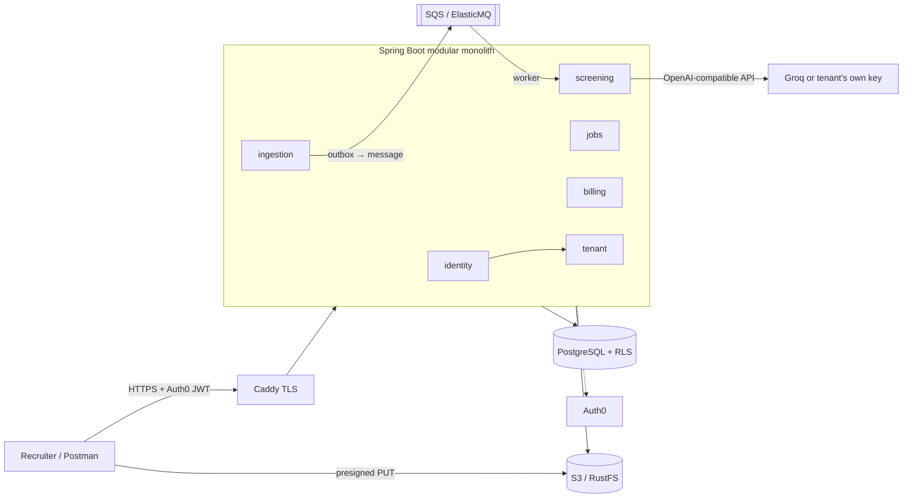
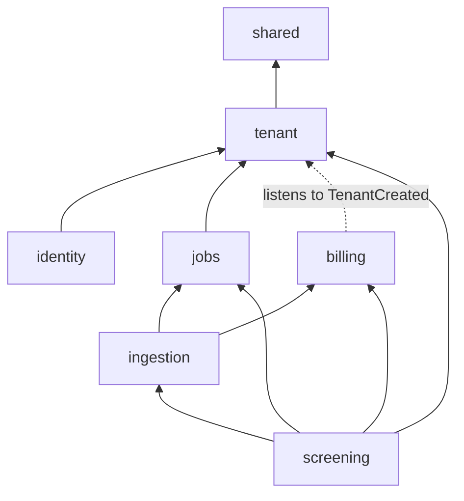
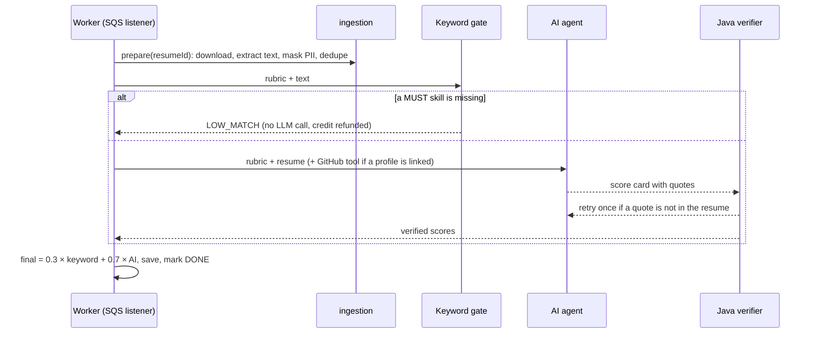

# spring-talent-engine

Multi-tenant AI resume screening platform. Companies upload batches of resumes against a job description; the app extracts a skill rubric, screens every resume with a keyword gate plus one tool-calling AI agent, **checks the AI's evidence in plain Java**, and returns a ranked, explainable shortlist that recruiters can override.

Built with Spring Boot 4, Spring AI 2, Spring Modulith, PostgreSQL row-level security, S3 and SQS. Runs locally on S3/SQS-compatible containers and was deployed to AWS for a one-week demo.

> Demo video: _coming soon_

## Highlights

- **Evidence-backed AI scoring.** The agent must quote the resume word for word for every skill it scores. Java verifies each quote; unsupported claims trigger one retry with feedback, then score 0 and are flagged.
- **Keyword gate before the LLM.** Missing a MUST skill means no LLM call (and no credit used). Synonyms (`k8s` → Kubernetes) and word boundaries (`Java` ≠ `JavaScript`).
- **Real multitenancy.** `tenant_id` on every row **and** PostgreSQL row-level security, with the app connecting as a non-owner database role so RLS cannot be bypassed.
- **Batch pipeline.** Presigned S3 uploads (no file bytes through the app), transactional outbox → SQS, rate-limit-aware worker with retries and a dead-letter queue, idempotent processing, live progress over SSE.
- **Billing.** Plans, 30-day periods, fake payment gateway behind an interface, append-only credit ledger with row-locked reservation and refunds.
- **BYOK.** Tenants can bring their own OpenAI-compatible key: AES-GCM encrypted, masked everywhere, SSRF-checked base URL, per-tenant AI client.
- **Human in the loop.** Recruiters edit the rubric before publishing and can override any score with a reason; every override is kept in history.
- **Model independent.** One OpenAI-compatible client; tested with Groq (`openai/gpt-oss-120b`).

## Architecture



| Concern | Local | AWS (demo week) |
|---|---|---|
| Files | RustFS (S3 API) | S3 |
| Queue | ElasticMQ (SQS API) | SQS + dead-letter queue |
| Database | PostgreSQL 17 | PostgreSQL 17 on the EC2 instance |
| Compute | your PC | one EC2 `t4g.small`, Docker Compose, Caddy |

Same code everywhere; only endpoints change by Spring profile.

### Modules (Spring Modulith)



| Module | Responsibility |
|---|---|
| `tenant` | Tenants, members, roles, BYOK settings |
| `identity` | JWT → current user, tenant resolution, role → permissions |
| `jobs` | Job descriptions, LLM rubric extraction, rubric editing |
| `billing` | Plans, subscriptions, fake payments, credit ledger |
| `ingestion` | Single and batch uploads, text extraction, PII masking, queueing |
| `screening` | Keyword gate, AI agent, evidence verification, ranking, overrides, usage |
| `shared` | Tenant context, current user, tenant-aware data source |

`ApplicationModules.verify()` runs as a test, so cycles or access to another module's internals fail the build. The same test writes PlantUML diagrams to `target/spring-modulith-docs`.

### Screening one resume



## Results

| What | Result |
|---|---|
| Eval: 6 hand-ranked resumes vs. the model ranking | pairwise agreement **1.00** |
| Keyword-stuffed resume (all skills listed, no experience) | keyword 100, AI 20 → ranked below a real junior |
| API checks on AWS (uploads, queue, SSE, credits, payments, BYOK, overrides, isolation) | **40/40** |
| 8-file batch on AWS, 2 workers | **19.4 s** from submit to complete |
| Tokens per AI-screened resume | about 2,200 |
| Cost | LLM $0 (Groq free tier); AWS about $4–5 per week, covered by free credits |

## Tech stack

Java 21 · Spring Boot 4.0.9 · Spring AI 2.0.1 (OpenAI-compatible) · Spring Modulith 2.0.8 · Spring Cloud AWS 4.2.1 · Spring Security resource server (Auth0) · Spring Data JPA, Flyway · PostgreSQL 17 · Apache Tika · springdoc · Testcontainers · Docker Compose · CloudFormation · Caddy.

## Running locally

Requirements: Java 21, Docker, an Auth0 tenant (free) and an OpenAI-compatible API key (for example Groq, free tier).

```bash
docker compose up -d
```

Set the environment variables listed in [`.env.example`](.env.example) (at least `AUTH0_ISSUER_URI`, `AUTH0_AUDIENCE`, `LLM_BASE_URL`, `LLM_API_KEY`, `LLM_MODEL`), then:

```bash
./mvnw spring-boot:run
```

- Flyway creates the schema and a separate non-owner database role for the app.
- Swagger UI: http://localhost:8080/swagger-ui.html
- Auth0 needs a post-login Action that puts the verified email in the access token, see [`docs/PLAN.md`](docs/PLAN.md).

Typical flow: `POST /tenants` → `POST /jobs` → review the rubric → `POST /jobs/{id}/publish` → `POST /jobs/{id}/batches` → upload to the presigned URLs → `POST /batches/{id}/submit` → `GET /batches/{id}/events` → `GET /jobs/{id}/results`. Send `X-Tenant-Id` on every tenant request.

## Tests

```bash
./mvnw test
```

- **Unit tests:** rubric cleaning, keyword gate, evidence verifier, scoring, PII masking, billing rules, BYOK URL check and encryption.
- **AI layer:** a scripted `ChatModel` (no network) tests the agent: one call, retry with feedback, zeroing invented evidence, bad replies, tool only when a GitHub profile is linked.
- **Tenant isolation:** Testcontainers PostgreSQL, app connects as the non-owner role, cross-tenant reads and writes are blocked by RLS.
- **Module boundaries:** `ApplicationModules.verify()`.
- **Eval:** `ScreeningEvalTests` runs only when `LLM_API_KEY` is set and compares the model ranking with a hand ranking.

## Deploying to AWS

Everything lives in [`infra/aws`](infra/aws): a budget stack (alerts on any spend not covered by credits), one CloudFormation stack (EC2, S3, SQS + dead-letter queue, least-privilege IAM role, no SSH port), [`compose.aws.yaml`](compose.aws.yaml) and a `Dockerfile`. Teardown is one stack delete. Step-by-step notes are in [`docs/PLAN.md`](docs/PLAN.md).

## Design decisions

- [ADR 0001: Modular monolith with Spring Modulith](docs/adr/0001-modular-monolith.md)
- [ADR 0002: One AI agent, verified in Java](docs/adr/0002-single-agent-with-java-verification.md)
- [ADR 0003: Shared schema with PostgreSQL row-level security](docs/adr/0003-row-level-security.md)
- [ADR 0004: S3 and SQS APIs with swappable endpoints](docs/adr/0004-swappable-s3-sqs-endpoints.md)
- [ADR 0005: Credits with a ledger and row-locked reservation](docs/adr/0005-billing-and-credits.md)

## Limitations and next steps

- No frontend yet (API only; the planned React app is described in `docs/PLAN.md`).
- The eval set is 6 synthetic resumes; it should grow to about 20 anonymized real ones.
- Payments are simulated; Stripe test mode would be a second `PaymentGateway`.
- Scanned (image-only) PDFs are rejected; no OCR.
